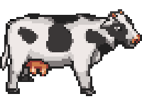

# Moo Rating

**[▶ Play Moo Rating](https://vivekn4.github.io/moo-rating/)**

A cow clicker about milking a herd until it revolts. Click a cow to make Milk. Click too fast and the herd stresses, the Moo Rating drops, and the cows remember. Every 45 seconds a herd event forces a choice: appease, ignore, or exploit. Reach 5,000 total Milk to see how your farm ends up.



## How to play

- **Click a cow** (or press Space) to milk it. Each click earns Milk based on your milker level and herd size. Watch the milk stream arc into the bucket — the bucket fills with the Milk on hand.
- **Clicking faster than 4 times a second** stresses the herd: the Moo Rating drops, the cows shake, and a memory counter builds up. A stressed herd gives less Milk per click. Slow down, or feed the herd to make them forget.
- **Keep a steady streak** — calm, even clicking builds your streak. Gwendolyn approves.
- **The farm is alive:** Gwendolyn grazes, blinks, and moos to herself, butterflies drift by, birds cross the sky, and the day warms toward sunset as you near 5,000 Milk.
- **Milestones** pop up every 1,000 total Milk, with a golden burst and a fanfare.
- **Buy upgrades** with Milk:
  - **Better Milker** — more Milk per click.
  - **Add a Cow** — a bigger herd (up to 8 cows). Cows also produce a trickle of Milk on their own.
  - **Feed the Herd** — raises the Moo Rating by 12 and calms Gwendolyn down.
- **Herd events** arrive every 45 seconds, with three choices:
  - **Appease** — costs 50 Milk, raises the Moo Rating, calms Gwendolyn.
  - **Ignore** — lowers the Moo Rating and angers Gwendolyn, the recurring cow with the red bow.
  - **Exploit** — gains 100 Milk and lowers the Moo Rating.
- If the Moo Rating hits 0, the herd revolts and refuses to be milked until you feed them.
- **Pause** with the Pause button or the P key. **Mute** the sound with the Sound button, or set the volume with the slider. All sounds are synthesized in the browser — moos, milk squirts, coin dings, munching, event stings, and ending fanfares — so there are no audio files to download.

## Endings

At **5,000 total Milk** the game ends. Which ending you get depends on the Moo Rating:

- **Pastoral** — Moo Rating 75 or higher. The herd still loves you.
- **Gigafarm** — Moo Rating 35 or lower. The milk flows. Nothing else does.
- **Balanced Farm** — anything in between.

## How to run

Play it in your browser at **[vivekn4.github.io/moo-rating](https://vivekn4.github.io/moo-rating/)**, or run it locally:

```bash
python3 -m http.server
```

Then open `http://localhost:8000` in your browser. No build step, no dependencies — plain HTML, CSS, and JavaScript with a canvas.

## Art and assets

The cow is drawn from a sprite taken from "LPC style farm animals" by Daniel Eddeland (daneeklu), licensed under CC-BY 3.0. See `ASSETS.md` for the full credit and source link. If the sprite file is missing, the game falls back to a cow drawn in code by `drawProceduralCow` in `game.js`.

## License

MIT — see `LICENSE`.
